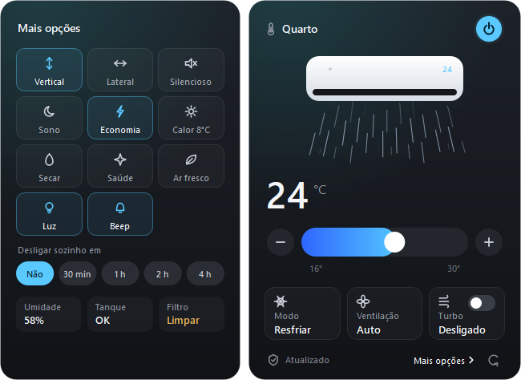

# Gree AC Tray ❄️

Controle seu ar-condicionado Gree pela rede local, direto da bandeja do Windows.

Aplicativo desenvolvido em **Python**, com interface em **PySide6** e comunicação com o aparelho por meio da biblioteca **greeclimate**. A interface e esta documentação estão em português brasileiro.



## Recursos

- Ligar e desligar o aparelho.
- Ajustar a temperatura configurada entre 16 °C e 30 °C.
- Alternar entre resfriar, aquecer, ventilar, desumidificar e automático.
- Ajustar a velocidade da ventilação e o turbo.
- Acessar opções adicionais em um painel lateral: oscilação, modo silencioso, sono, economia, luz e outras funções.
- Programar o desligamento em 30 minutos, 1, 2 ou 4 horas.
- Atualizar a interface automaticamente após cada comando confirmado pelo aparelho.
- Usar um modo de demonstração sem conexão com um ar-condicionado.
- Iniciar com o Windows e permanecer na bandeja do sistema.

A disponibilidade das funções depende do modelo e do firmware do aparelho. O temporizador pertence ao aplicativo: o computador e o programa precisam permanecer ligados e ativos até o horário de desligamento.

A temperatura exibida no controle principal é a **temperatura configurada**. A leitura do sensor ambiente foi removida do cabeçalho devido a valores inconsistentes no aparelho utilizado.

## Requisitos

- Windows com bandeja do sistema disponível.
- Python 3.12 recomendado; desenvolvimento realizado com Python 3.12.
- Para uso real, um aparelho Gree compatível com `greeclimate`, configurado na rede e acessível pelo computador.

## Instalação

No PowerShell:

```powershell
git clone https://github.com/mateuspserra/gree-ac-tray.git
cd gree-ac-tray
python -m venv .venv
.\.venv\Scripts\python.exe -m pip install -r requirements.txt
```

## Experimentar a interface

Não exige um aparelho conectado:

```powershell
.\.venv\Scripts\python.exe ac_tray.py --demo --name Quarto --open
```

## Controlar o aparelho

Buscar automaticamente na rede e abrir a interface:

```powershell
.\.venv\Scripts\python.exe ac_tray.py --name Quarto --open
```

Informar o endereço IP do seu aparelho:

```powershell
.\.venv\Scripts\python.exe ac_tray.py --ip 192.168.0.50 --name Quarto --open
```

O IP acima é apenas um exemplo; substitua pelo endereço do seu ar na lista de dispositivos do roteador.

| Argumento | Função |
| --- | --- |
| `--demo` | Exibe dados simulados, sem acessar o aparelho. |
| `--ip ENDEREÇO` | Direciona a descoberta ao IP informado. |
| `--name NOME` | Define o nome exibido no aplicativo. |
| `--open` | Abre a interface ao iniciar. |

Clique no ícone da bandeja para abrir ou ocultar a janela. O botão **Mais opções** abre o painel lateral. Para encerrar, clique com o botão direito no ícone e escolha **Sair**. Fechar o painel mantém o programa na bandeja.

## Como funciona

1. O aplicativo procura aparelhos Gree na rede local ou consulta o IP informado.
2. Estabelece a comunicação com o aparelho e consulta seu estado.
3. Os comandos da interface são enviados por uma tarefa assíncrona, sem bloquear a janela.
4. Após uma alteração, aguarda a confirmação e solicita uma nova leitura do estado para atualizar a interface.
5. Também consulta periodicamente o aparelho quando não há comandos pendentes.

A interface usa sinais do Qt para receber os resultados. A comunicação assíncrona roda em uma thread separada. Alterações rápidas são agrupadas antes do envio para reduzir comandos consecutivos.

## Gerar o executável

Com o ambiente virtual instalado, execute:

```powershell
.\gerar_executavel.ps1
```

O script instala as ferramentas de empacotamento e gera:

```text
dist/ArCondicionado/ArCondicionado.exe
```

Mantenha a pasta `ArCondicionado` inteira: o executável depende dos arquivos que a acompanham. A geração usa PyInstaller com `--noconsole`, portanto nenhuma janela de terminal aparece ao abrir o aplicativo.

O script também trata o conflito de `icuuc.dll` identificado no ambiente Windows de desenvolvimento, usando a biblioteca do próprio Windows quando disponível.

## Iniciar com o Windows

Depois de gerar o executável:

```powershell
.\iniciar_com_windows.ps1 -Nome Quarto
```

O script cria um atalho na pasta Inicializar do usuário atual. Ele aponta para o executável gerado e inicia o aplicativo na bandeja. Se mover a pasta do aplicativo, execute o script novamente.

Para remover a inicialização automática:

```powershell
.\iniciar_com_windows.ps1 -Remover
```

## Se aparecer “Sem conexão”

- Confira se o aparelho está ligado à rede e se o computador consegue acessá-lo.
- Se o Firewall solicitar permissão para o aplicativo, permita na rede privada utilizada pelo aparelho.
- Verifique se a rede de convidados ou o isolamento de clientes do roteador bloqueia a comunicação.
- Tente informar o IP correto com `--ip`.
- O endereço direto não contorna bloqueios de firewall ou ausência de rota entre redes.

## Estrutura

```text
ac_tray.py                  # Interface, comunicação e temporizador
requirements.txt            # Dependências do aplicativo
requirements-dev.txt        # Ferramentas para empacotamento
gerar_executavel.ps1        # Geração do aplicativo Windows
iniciar_com_windows.ps1     # Atalho de inicialização automática
imagens/interface.png       # Interface com dados de demonstração
CONTRIBUTING.md             # Orientações para contribuir
```

## Desenvolvimento

Projeto criado a partir de uma necessidade cotidiana: controlar o ar pelo computador.

Foram verificados a criação da interface, a abertura e o fechamento do painel lateral, a descoberta e a leitura de um aparelho real e a execução do aplicativo empacotado no Windows. A compatibilidade com outros modelos depende dos recursos expostos pela biblioteca e pelo aparelho.

Sugestões e relatos de problemas são bem-vindos nas [issues](https://github.com/mateuspserra/gree-ac-tray/issues). Veja as [orientações para contribuir](CONTRIBUTING.md).
